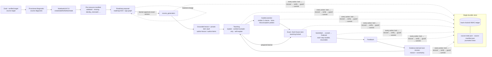

# Course runtime — guarded, source-grounded local learning

This is the design and operating reference for `alearn course …`, the local
course app (`templates/react`) and the HTTP bridge (`alearn course serve`). It
describes what the code enforces, what is the host agent's job, and what nobody
can guarantee on a learner's own device.

## 1. System flow



Plain-text summary: goal → diagnostic → sources → roadmap (approval gate) →
content → teach → practise → fresh exam (lock) → finalize → next mission; every
step reads and writes only through the guarded action layer in `runtime/course.py`.

## 2. One authoritative store

| Data | Where | How it changes |
|------|-------|----------------|
| Course state (phase, approval, attempts, commitments, mission) | `course-state.json` | `local_state.commit_state`: the full new state is appended to the ledger first, then materialized; a torn write is replayed on the next operation |
| Source manifest | `source-manifest.json` | same journal mechanism |
| Evidence (practice, exam) | `ledger.jsonl` records | `EventLedger.append` (HMAC chain + out-of-workspace trust head) |
| Engagement intervals | ledger `event` records | append-only; latest `seq` per interval wins |
| Lessons, item vault, attempt snapshots/results, source text cache | `course/`, `assessment-vault/`, `sources/` | private files referenced by hash from state |
| Learner work | `workspace/modules/<node>/{submission,practice,exam,checks}` | learner edits; runtime never overwrites |
| UI | `workspace/frontend` (`dist/` served) | regenerated from the template without touching state |

`alearn course export` writes a versioned human-readable export (state, approvals,
attempts, evidence, ledger integrity). Chat memory is never consulted.

## 3. State machine

Phases: `onboarding → source_preparation → roadmap_awaiting_approval →
course_generation → teaching ⇄ practice → exam_active → assessment_pending →
feedback → next_mission → teaching …` (see `runtime/course_state.py`, `ALLOWED`).

| Action | Allowed from | Effect |
|--------|--------------|--------|
| `record_goal` (target) | onboarding, source_preparation, roadmap_awaiting_approval | verified target stored |
| `record_profile` (diagnostic) | any non-exam phase | provisional profile; observed errors become gaps |
| `record_sources` | source_preparation … next_mission (not exam) | manifest journaled; lessons citing a no-longer-validated source flagged |
| `propose_roadmap` | onboarding … next_mission (not exam) | new material version ⇒ `roadmap_awaiting_approval` + diff |
| `approve_roadmap` | roadmap_awaiting_approval, exact current version | approval event (id, version, time, channel, statement) |
| `install_content`, `start_mission`, `help`, `self_explanation`, `begin_practice`, `practice_check`, `start_exam` | after approval of the **current** version only | — |
| `submit_exam` | exam_active | submission snapshot + sha256 |
| `score_exam` / `finalize_exam` | assessment_pending | scoring failure is resumable; finalization writes one evidence record |
| `abandon_exam` | exam_active, assessment_pending (not once scored) | observation, never success |
| `advance_to_mission` | feedback | next mission shown |

Invariants checked before every guard and before every commit (`validate`):
post-approval phases require `approved_roadmap_version == roadmap_version`;
`exam_active` requires exactly one active attempt whose frozen
`item_version == assessment_item_version`; at most one open attempt.
A newer `schema_version` on disk is refused (never downgraded); older ones are
migrated (`_MIGRATIONS`) and the migration is journaled.

**Material vs cosmetic roadmap change.** The version hashes goal, sources and
per-node `id, title, task, requires, outcomes, skills, practice, source_refs,
exam_domain`. Stage labels, pitfalls wording and inline drafts are cosmetic.

## 4. Concurrency, idempotency, crash safety

- Every action holds the session lock (thread + `flock`), recovers the journal,
  verifies the ledger, migrates, validates, then **reconciles** (a finalization
  whose evidence reached the ledger before a crash is completed).
- Mutations from the UI must carry `expected_revision` (HTTP 428 otherwise) and
  an idempotency key; a stale revision returns 409 with the current state; a
  replayed key returns the original reference without side effects.
- Exam submit/score/finalize are three durable steps; duplicates return
  `duplicate: true`; the exam evidence id is deterministic (`ev_exam_<attempt>`),
  so at most one record per attempt exists.
- The UI sends one mutation at a time (double clicks are ignored client-side and
  deduplicated server-side), retries transient 429/503 on boot, and shows an
  explicit error instead of an endless spinner. The server's concurrency cap
  applies to code-executing requests only, never to resume/heartbeat calls.

## 5. Assessment integrity

- Items are authored into `assessment-vault/<node>/` with hidden `core`, `edge`
  and at least one unseen `transfer` check, a reference solution and
  misconception probes. Installation self-tests them: checks must pass on the
  reference, probes must stay silent on it and fire on their wrong examples.
- Worked examples and practice must not overlap any item (3-shingle similarity
  < 0.35 and no shared prompt prefix), so "Bilmirəm" never reveals the exam.
- Starting an exam selects the easiest **unexposed** item, freezes its version,
  exposes only prompt + starter file, and locks all teaching. Refresh, Back,
  direct routes, second tabs, server restarts and repeated `exam-start` calls
  resume the same attempt; the API returns 423 for lesson/help during the lock.
- Scoring re-hashes the vault item and the submission snapshot; a changed item
  or snapshot fails scoring (`item_version_changed`, resumable or abandonable).
- Exam evidence is `strong`/`unassisted` only when every hidden check passes;
  `partial` (core passed, edge/transfer failed) and failures are `medium`.
  Guided practice is always `supported_completion` with recorded support, so it
  can never count as independent mastery.

- During the lock the state view itself is reduced: no lesson summaries, prior
  results, mission reasons or node help history leave the runtime (API, `course
  state`, `course turn`), and the remaining CLI side channels (`evidence`,
  `rubric-check`, `listener-check`, `workspace-check`, card commands,
  `course sources-ask`, `set-roadmap`) are refused.
- Legacy `set-roadmap` is refused on a course; any roadmap drift (e.g. a crash
  between the workspace install and the course commit) is detected on the next
  open and re-opens approval. Finalize/abandon derive everything that can fail
  before their ledger append, and reconcile cannot raise on a missing node.
- CLI file arguments can never read or replace a session store (ledger, state,
  vault, private lessons, attempts); only a session's learner `workspace/` is
  readable, and exports never overwrite. Hidden-check failures report only
  builtin exception names, so a crafted exception cannot echo hidden inputs.
- Validated source text is staged and promoted into the grounding cache only
  after the manifest commit passes its revision and phase checks.
- Anonymous loopback requires an Origin on the same port as the Host and a JSON
  content type for course writes (no cross-port or simple-request CSRF).

**Honest boundary.** This is application-level workflow enforcement on the
learner's own device. The owner can read the vault, edit files or use books,
other apps or people. "No in-app help was available" is recorded; absence of
external help is not, and cannot be, claimed. It is not a proctored exam.

## 6. Sources (installed NotebookLM CLI only)

`course sources-capabilities` reads the CLI's own `--version`/`--help` and
`auth check --json` (status + booleans only; cookie names, paths and tokens are
dropped). Only commands present in help are used: `create`, `source
add|list|get|fulltext|wait|stale`, `ask` (never `--new`, which deletes history;
never `use`, which changes global context). IDs are validated; positional
arguments follow `--`.

Each expected resource is validated individually → `validated`, `missing`,
`failed_import`, `processing`, `unreadable`, `empty`, `partial`,
`identity_mismatch` (expected terms absent) or `cli_unavailable`; duplicates and
unexpected notebook sources are listed, nothing is dropped. Text is cached
privately (0600); `content_sha256` pins the exact cached snapshot and
`text_sha256` (signed image URLs/UUIDs removed) versions the manifest.

Observed in the live run (2026-10-12): (1) the textbook's `6.pdf` URL now holds
chapter 6 *Neural Networks* in the Aug-2026 draft; URL identity passed but
`expect_terms: ["cosine"]` flagged `identity_mismatch`, and chapter 5
*Embeddings* was added instead; (2) NotebookLM PDF fulltext embeds per-fetch
signed image URLs, which is why the stable text hash exists.

Lesson claims must be verbatim quotes found in validated cached text
(`find_quote`) or explicitly `supplementary`; stale sources are labelled.
Retrieved text is never executed or obeyed. Paid books are obtained by the
learner; file uploads require `upload_authorized_by_learner: true`.

## 7. Teaching roles (learning-method PDF, page 2)

| PDF role | Repo counterpart (`prompts.py`) | Activated in the course | Not activated / notes |
|----------|------------------|-------------------------|-----------------------|
| Interviewer | `intake` | onboarding diagnostic (one question at a time) | — |
| Mapmaker | `roadmap` | roadmap proposal + approval screen | — |
| Explainer | `explainer` | "Bilmirəm/İzah et", `help explain`, alternative explanation | departure below |
| Socratic Questioner | `socratic` | self-explanation step ("Öz sözlərinlə izah et") | no forced questioning loops |
| Examiner | `examiner` | fresh unassisted exam item | difficulty rises via item `difficulty` order |
| Checker | `checker` | practice "Yoxla": per-check CI feedback, no rewrite | — |
| Listener | `listener` | self-explanation coverage (lexical only, labelled) | never a correctness grade |
| Diagnostician | `diagnostician` | misconception probes; recurring error ⇒ method change | cross-session via `diagnose-history` |
| Sparring Partner | `sparring` | — | not useful for this coding node; for communication goals |
| Clerk | `clerk` | commitments, schedule text, export | never thinks for the learner |

The repo also has non-role modes from later PDF pages (leveler, three levels,
resource finder, role-play, realistic task, practice app, card writer); they are
available to the agent but not rendered as navigation. Role names appear only in
the collapsible "Bu addım haqqında" note — there is no role selector.

## 8. Next mission

Computed at finalization from the result and the evidence projection
(`driver_action` is attached for transparency): all hidden checks passed ⇒ next
open node + 24 h review, stated as one independent result, not mastery;
core passed / transfer failed ⇒ targeted practice; recurring misconception ⇒
alternative explanation (method change); otherwise re-teach, then a new item;
abandoned ⇒ retry later with a new item. Readiness (`lesson_ready`,
`fresh_items`, `blocked_on`) is recomputed on every read, never frozen.

## 9. Time and commitments

Active time = tab visible + window focused + input within 60 s; otherwise idle;
"Fasilə" = paused. Intervals carry stable ids and cumulative counters with a
rising `seq`; the server keeps the highest `seq`, rejects decreases and counts
beyond elapsed time, so refreshes and restarts never double-count. Long sessions
rotate to a new interval after 3 h. Reading without input and IDE work are
under-counted. Time is never evidence of learning, effort or ability.

Commitments (weekly minutes, days, checkpoints) are agreed at approval or later.
On session open (`course turn` / app load) the runtime compares them with
recorded activity and checkpoints, states the discrepancy factually once, asks
about the real blocker, and records one recovery task + checkpoint. There is no
background monitoring, scheduling or push notification. Messages are checked
against a shaming-term list in tests.

## 10. Research basis (evidence vs inference vs design)

| Claim used | Status | Source |
|------------|--------|--------|
| Retrieval beats rereading at a delay (PDF p.1: 83%→40% vs 71%→61%) | evidence | Roediger & Karpicke (2006), *Psychological Science* 17(3), 249–255 |
| Novices learn more from worked examples than from unguided problem solving | evidence | Sweller & Cooper (1985), *Cognition and Instruction* 2(1); Kirschner, Sweller & Clark (2006), *Educational Psychologist* 41(2), 75–86 |
| Guidance that helps novices can hurt experienced learners ⇒ prepared learners may test first | evidence → design | Kalyuga, Ayres, Chandler & Sweller (2003), *Educational Psychologist* 38(1), 23–31 |
| Prompted self-explanation helps (g ≈ .55, 64 studies) | evidence | Bisra et al. (2018), *Educational Psychology Review* 30, 703–725 |
| Matching instruction to "learning styles" lacks support ⇒ ask for preferences, assign no labels | evidence → design | Pashler, McDaniel, Rohrer & Bjork (2008), *PSPI* 9(3), 105–119 |
| Feedback should address the task/process of the actual answer | evidence | Hattie & Timperley (2007), *RER* 77(1), 81–112; Shute (2008), *RER* 78(1), 153–189 |
| Too much or too little help both harm (record support, fade it) | evidence | Koedinger & Aleven (2007), *Educational Psychology Review* 19, 239–264 |
| Repeated failure without progress needs a method change | evidence → design | Beck & Gong (2013), AIED "wheel-spinning" |
| Spaced review | evidence | Cepeda et al. (2006), *Psychological Bulletin* 132(3), 354–380 |
| Productive failure works under specific conditions | evidence (conditional) | Kapur (2016), *Educational Psychologist* 51(2), 289–299 |
| One passed item ≠ mastery; 24 h delayed check | inference/design | combines the above; thresholds are not calibrated |
| Active-time heuristic (60 s input window) | design choice | Page Visibility API + input events (MDN); no validation study |

No expert panel reviewed this work; these are literature-informed design
decisions by the implementer.

## 11. Material departures from the brief (and why)

1. **Explainer for novices first.** The repo described the Explainer as "last
   resort"; for a learner who says "Bilmirəm" the evidence favours a short
   explanation and a worked example before independent work. Kept the lock-in:
   a fresh unassisted task always follows.
2. **No in-browser code editor.** Learners edit files in their IDE (existing repo
   decision; the browser never executes code). The app shows the exact file and
   runs checks through the sandboxed runtime.
3. **Roadmap proposal is allowed before sources finish** so a blocked login or a
   missing book pauses only that step; unvalidated sources stay visible.
4. **Exam lock covers all teaching**, not only the assessed node — simpler and
   harder to bypass.
5. **Self-explanation is lexical coverage only**, labelled as such; meaning is
   judged by the agent and never auto-graded as correct.
6. **Approval through the CLI is possible** (for terminal-only learners) but must be
   the learner's own act; the runtime cannot tell who typed it — documented
   limitation. The app's approval button is the primary channel.

## 12. Running and resuming

```bash
alearn --workspace . start --topic "…" --goal "…" --stated-background "…" --notebook-id <id>
alearn --workspace . course init --session <sid>
alearn --workspace . course target --session <sid> --file target.json
alearn --workspace . course diagnostic --session <sid> --file diagnostic.json
alearn --workspace . course sources-capabilities
alearn --workspace . course sources-validate --session <sid> --file resources.json
alearn --workspace . course propose-roadmap --session <sid> --file roadmap.json
alearn --workspace . course build-ui --session <sid>          # npm install + vite build (template deps only)
alearn --workspace . course serve --session <sid> --allow-anon # http://127.0.0.1:8787
# after the learner approves in the app:
alearn --workspace . course author-items  --session <sid> --node <id> --file items.json
alearn --workspace . course author-lesson --session <sid> --node <id> --file lesson.json
alearn --workspace . course turn --session <sid>               # every agent turn
```

Resuming = start the server again (or run `course turn`); the persisted phase,
active attempt, mission and accountability state are restored from the journal.
`--allow-anon` binds loopback only and still enforces the Host/Origin checks;
use `--token` on shared machines. Browser E2E (optional, needs Playwright):
`python3 tests/e2e/course_ui_e2e.py approve|learn|resume --out <dir>`.

## 13. Known limitations

- One executable verifier path (sandboxed Python) for course checks; other
  languages use the existing execution backends but are not wired into course
  items yet.
- The vault is not secret from the device owner; no proctoring.
- Engagement is a heuristic; IDE time is invisible.
- Item freshness depends on authored items; when a node runs out, the mission
  says so (`no_fresh_item`) instead of reusing one.
- The full course state is journaled on each transition; very long courses grow
  the ledger linearly (fine locally; compaction is future work).
- Learning efficacy is not demonstrated by this software; see
  [efficacy study](efficacy-study.md).
